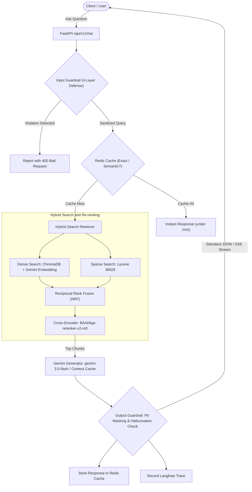

# Enterprise Core RAG Service

Production-ready asynchronous Retrieval-Augmented Generation (RAG) system built with **FastAPI**, **ChromaDB**, and **Google Gemini** (`gemini-3.5-flash`, `gemini-embedding-001`).

---

## 1. System Architecture

### Query & Generation Pipeline



### Document Ingestion Pipeline

```mermaid
flowchart LR
    Doc["PDF / TXT Document"] --> API_Ingest["POST /api/v1/ingest"]
    API_Ingest --> Task["Generate Background Task ID"]
    Task --> Splitter["RecursiveCharacterTextSplitter (Chunk: 1000, Overlap: 200)"]
    Splitter --> Embed["Gemini Embedding-001 (Batch: 100 docs, Dim: 768)"]
    Embed --> ChromaDB[("ChromaDB Vector Store")]
    ChromaDB --> ClearCache["Invalidate Redis Collection Cache"]
    ClearCache --> Done["Ingestion Complete"]
```



---

## 2. Project Structure

```text
raw_rag_project/
├── .env                       # Environment variables configuration
├── .env.example               # Template environment configuration
├── requirements.txt           # Python dependencies
├── Dockerfile                 # Container deployment specification
├── chroma_data/               # Persistent ChromaDB storage directory
├── data/
│   ├── samples/               # Sample testing documents (e.g. sample.txt)
│   └── uploads/               # Temporary directory for file uploads
├── scripts/
│   └── test_pipeline.py       # Standalone end-to-end verification script
├── src/
│   ├── main.py                # FastAPI entry point, middleware, CORS, lifecycle
│   ├── config.py              # Centralized configuration via Pydantic BaseSettings
│   ├── api/
│   │   └── v1/
│   │       ├── router.py      # Aggregated API v1 router
│   │       └── endpoints/
│   │           ├── chat.py    # Query endpoint (JSON & SSE stream) & feedback
│   │           └── ingest.py  # Asynchronous document upload & task tracking
│   ├── core/
│   │   ├── ingestion.py       # Document loaders, text splitting, Gemini embedding
│   │   ├── retriever.py       # Hybrid retrieval: Dense Vector + Lucene BM25 + RRF
│   │   ├── reranker.py        # Cross-Encoder re-ranker (BAAI/bge-reranker-v2-m3)
│   │   └── generator.py       # Gemini interaction, context caching, prompt formatting
│   ├── guardrails/
│   │   ├── input_guard.py     # 4-layer defense: Unicode, structural, script, prompt injection
│   │   └── output_guard.py    # PII masking (phone, ID, email) & hallucination detection
│   ├── models/
│   │   └── schemas.py         # Pydantic request / response / task schemas
│   ├── services/
│   │   ├── vector_db.py       # ChromaDB client connection & collection management
│   │   ├── cache_service.py   # Two-tier Redis cache (Tier-1 exact & Tier-2 semantic)
│   │   ├── task_store.py      # In-memory tracking for ingestion background tasks
│   │   └── tracing.py         # LLMOps distributed tracing with Langfuse
│   └── utils/
│       └── logger.py          # Structured logging configuration with Loguru
└── tests/                     # 133 automated unit and integration tests
    ├── conftest.py
    ├── test_api_chat.py
    ├── test_api_ingest.py
    ├── test_cache_service.py
    ├── test_e2e_pipeline.py
    ├── test_generator.py
    ├── test_ingestion.py
    ├── test_input_guard.py
    ├── test_main_middleware.py
    ├── test_output_guard.py
    ├── test_reranker.py
    ├── test_retriever.py
    └── test_tracing.py
```

---

## 3. Installation & Setup

### Prerequisites

- **Python**: Version `3.10` or higher (recommended: `3.11`).
- **Google Gemini API Key**: Obtainable from [Google AI Studio](https://aistudio.google.com/).
- **ChromaDB**: Standalone vector database server.
- **Redis Server** *(Optional, recommended)*: For exact and semantic response caching.

### Step 1: Create Virtual Environment

Using **Conda**:
```bash
conda create -n raw-rag python=3.11 -y
conda activate raw-rag
```

Or using **venv**:
```bash
python -m venv .venv
# On Windows:
.venv\Scripts\activate
# On Linux / macOS:
source .venv/bin/activate
```

### Step 2: Install Dependencies

```bash
pip install -r requirements.txt
```

### Step 3: Configure Environment Variables

Create your `.env` file by copying the provided template:

```bash
cp .env.example .env
```

Configure your credentials and system parameters in `.env`:

```ini
# Google Gemini & ChromaDB
GEMINI_API_KEY=your_gemini_api_key_here
VECTOR_DB_URL=http://localhost:8000
CHROMA_COLLECTION_NAME=documents

# Embeddings & Chunking
EMBEDDING_MODEL_NAME=gemini-embedding-001
EMBEDDING_DIMENSION=768
EMBEDDING_BATCH_SIZE=100
CHUNK_SIZE=1000
CHUNK_OVERLAP=200

# Retrieval & Re-ranking
DEFAULT_TOP_K=5
MAX_TOP_K=50
USE_RERANKER=true
RERANKER_MODEL_NAME=BAAI/bge-reranker-v2-m3
RERANK_CANDIDATE_K=25

# Generator (Gemini LLM)
GENERATION_MODEL_NAME=gemini-3.5-flash
GENERATION_TEMPERATURE=0.2

# Redis Two-Tier Cache (Optional)
REDIS_URL=redis://localhost:6379/0
ENABLE_QUERY_CACHE=true
QUERY_CACHE_TTL_SECONDS=3600
ENABLE_SEMANTIC_CACHE=false

# Guardrails
ENABLE_INPUT_GUARD=true
ENABLE_OUTPUT_GUARD=true
MASK_PII_IN_SOURCES=true

# LLMOps Tracing (Optional)
ENABLE_TRACING=false
LANGFUSE_PUBLIC_KEY=
LANGFUSE_SECRET_KEY=
LANGFUSE_HOST=https://cloud.langfuse.com
```

### Step 4: Run the Services

1. **Start ChromaDB Server** (Port `8000`):
   ```bash
   chroma run --path ./chroma_data --port 8000
   ```

2. **Start Redis Server** *(Optional, via Docker on Port `6379`)*:
   ```bash
   docker run -d --name redis-cache -p 6379:6379 redis:alpine
   ```

3. **Start Core FastAPI Application** (Port `8080`):
   ```bash
   uvicorn src.main:app --host 0.0.0.0 --port 8080 --reload
   ```

Once started:
- **Interactive Swagger Documentation**: `http://localhost:8080/docs`
- **ReDoc Documentation**: `http://localhost:8080/redoc`
- **Health Check**: `http://localhost:8080/health`
